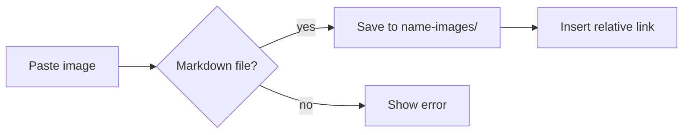
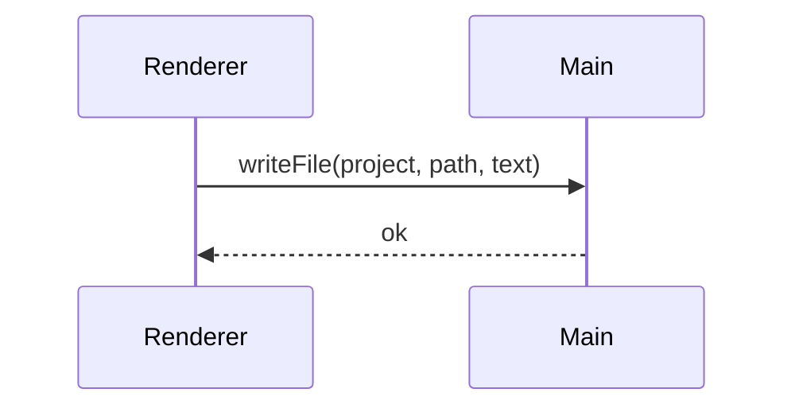
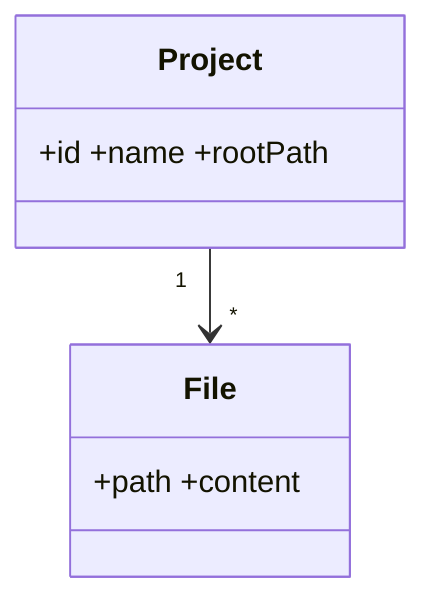

# GFM Showcase

This file exercises every Markdown feature the preview supports. Open it in **Split** view (`Ctrl+2`).

## Text

Regular, **bold**, *italic*, ***both***, ~~strikethrough~~, `inline code`, and <kbd>Ctrl</kbd>+<kbd>S</kbd>.
Autolink: https://github.com and www.example.com. Footnote-style reference [link][ref].

[ref]: https://github.github.com/gfm/

## Lists

1. First
2. Second
   - Nested bullet
   - Another
     1. Deep ordered
3. Third

### Task list

- [x] Write the plan
- [x] Build the editor
- [ ] Ship v1

## Table

| Feature        | Supported | Notes                    |
| :------------- | :-------: | -----------------------: |
| Tables         |    ✅     | alignment works          |
| Task lists     |    ✅     | GitHub style             |
| Mermaid        |    ✅     | lazy-loaded              |
| Raw `<script>` |    ❌     | sanitised by DOMPurify   |

## Blockquote

> Markdown is intended to be as easy-to-read and easy-to-write as is feasible.
>
> > Nested quotes work too.

## Code

```typescript
interface Project {
  id: string;
  name: string;
}
export const greet = (p: Project): string => `Hello, ${p.name}!`;
```

```python
def fib(n: int) -> int:
    return n if n < 2 else fib(n - 1) + fib(n - 2)
```

```bash
npm install && npm run dev
```

```json
{ "autosave": { "enabled": true, "delayMs": 1000 } }
```

## Mermaid







## Links

- [Jump to Table](#table)
- [External site](https://example.com)

---

*End of showcase.*
